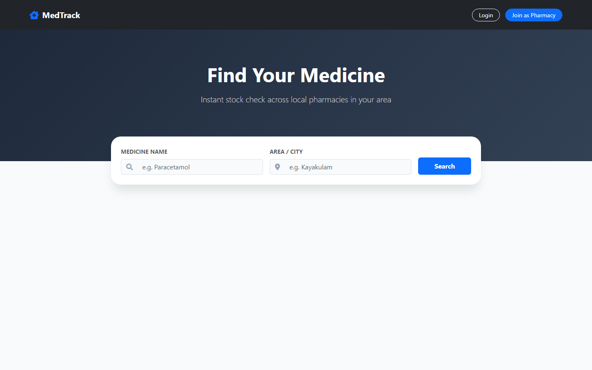
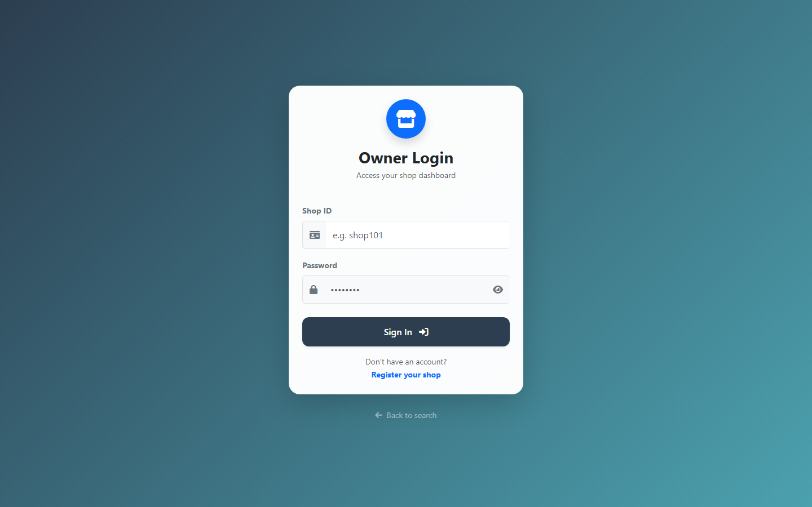
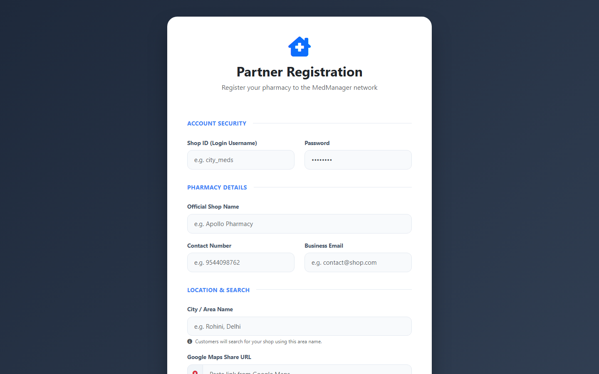
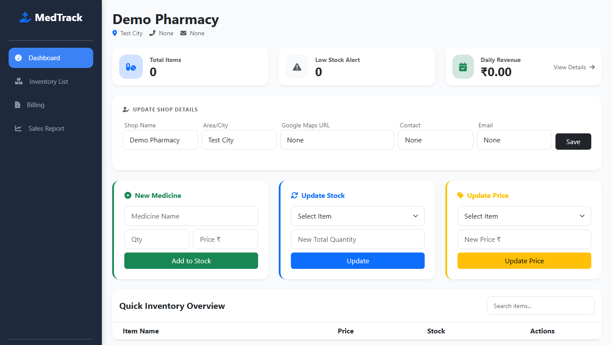

# MedTrack

MedTrack is a lightweight pharmacy inventory and sales management web app built with **Flask** and **SQLite**. It lets people search for available medicines across nearby pharmacies and lets pharmacy owners manage their shop's stock, billing, and sales reports.

## Features

- **Public medicine search** by medicine name and area/city
- **Shop registration and login** with session-based authentication
- **Owner dashboard** with today's revenue summary
- **Inventory management**: add medicines, update stock/price, quick stock +/- actions, delete items
- **Billing**: record sales, automatically deduct stock, and calculate totals
- **Sales reports** with daily revenue and transaction counts
- **Account deletion** with cleanup of related inventory and sales data

## Screenshots

Screenshots from the live demo deployment.

### Home — medicine search



### Shop login



### Shop registration



### Owner dashboard



## Tech stack

- Python 3
- Flask (Jinja2 templates)
- SQLite
- Gunicorn (production WSGI server)
- Vercel (serverless deployment)

## Project structure

```text
.
├── app.py               # Flask application and all routes
├── api/index.py         # Vercel Python entry point
├── pharmacy.db          # Bundled SQLite database (empty by default)
├── requirements.txt     # Python dependencies
├── screenshots/         # README screenshots
└── templates/           # Jinja2 HTML templates
```

## Run locally

```bash
# Create and activate a virtual environment
python -m venv .venv
# Windows
.venv\Scripts\activate
# macOS / Linux
source .venv/bin/activate

# Install dependencies
pip install -r requirements.txt

# Start the app
python app.py
```

Open http://localhost:5000 in your browser.

The bundled `pharmacy.db` starts empty. Register a shop, then add medicines from the dashboard to see search and billing in action.

## Environment variables

| Variable | Required | Description |
| --- | --- | --- |
| `SECRET_KEY` | Recommended | Secret used to sign Flask session cookies. A weak default is used if not set. |
| `DATABASE_PATH` | Optional | Override the SQLite file path. Defaults to a writable temp directory on Vercel. |

## Deploy to Vercel

The project is deployed at: https://medtrack-theta-two.vercel.app

Vercel detects the Flask app from the top-level `app.py`. To deploy your own copy:

1. Push this repository to GitHub.
2. Import the repository in Vercel, or run `vercel` from the project folder.
3. Set `SECRET_KEY` in **Project Settings → Environment Variables**.
4. Deploy. `requirements.txt` is used to install dependencies automatically.

### Storage note

Vercel's filesystem is read-only except for `/tmp`, so the app copies the bundled `pharmacy.db` into a writable temp location on cold start. This means **data is not permanently persisted** across serverless instances. For production use with real data, connect a hosted database such as Vercel Postgres/Neon or Supabase and update `get_db_connection()` in `app.py`.

## License

No license specified. Add one if you plan to share or reuse this project.
